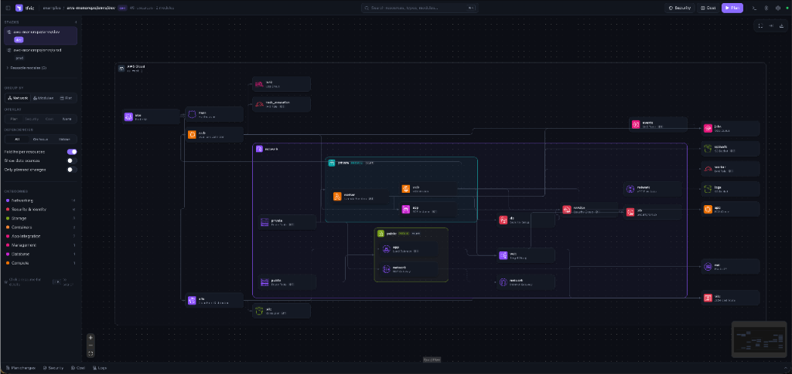

# tfviz

A local visualiser for Terraform. Point it at a repo, get a searchable architecture diagram, then run `terraform plan` and see the changes on the same canvas.

No login, no cloud, no telemetry. It binds to localhost and never ships your code anywhere.

AWS is the first-class provider (official icons, VPC/subnet nesting, helper-resource folding). Other providers still render.



## Run

Needs [Go 1.22+](https://go.dev/dl/) and [Node 20+](https://nodejs.org/) with [pnpm](https://pnpm.io/). Terraform is optional until you want a plan.

```bash
make build
./bin/tfviz path/to/your/terraform
```

A browser tab opens on `http://127.0.0.1:7777`. For a monorepo, pass the repo root — stacks are discovered automatically.

```bash
./bin/tfviz examples/aws-monorepo
```

### Flags

| Flag | Default | |
| --- | --- | --- |
| `-port` | `7777` | Next free port is used if taken |
| `-host` | `127.0.0.1` | Bind address |
| `-no-open` | | Don't open the browser |
| `-no-watch` | | Don't live-reload on `.tf` changes |
| `-terraform` | `terraform` or `tofu` on `$PATH` | Binary to run |
| `-dev` | | API only; UI comes from Vite (`make dev`) |

Overrides: `TFVIZ_TERRAFORM`, `TFVIZ_CHECKOV`, `TFVIZ_C3X`. `TFVIZ_C3X_OFFLINE=1` forces cached prices only.

### Develop the UI

```bash
DIR=examples/aws-monorepo make dev
# then open http://127.0.0.1:5173
```

## What it does

- **Diagram** — resources laid out as a network map (VPC → subnet → resource), a module tree, or a flat graph. Search with `⌘K` / `/`. Click a node for source, references, and diffs. `F` fits the view.
- **Plan** — runs `terraform plan` from the UI (var files, workspace, AWS profile, destroy preview). Live logs, then green/amber/red overlays on the diagram plus an attribute-level diff. Plan is read-only.
- **Security** — [Checkov](https://www.checkov.io/) findings mapped onto nodes. Optional.
- **Cost** — C3X monthly estimate, using the last plan JSON when one exists. Optional.
- **Export** — PNG or SVG of the current view.

Helper resources (route table associations, IAM attachments, SG rules, listeners, …) fold into the thing they belong to. Toggle that off in the sidebar.

## Environments (tfvars + backend configs)

A root module can be many environments without copying the `.tf` files. tfviz treats each named pair of files as an env you can plan separately:

| | In a subfolder | Next to the `.tf` files |
| --- | --- | --- |
| Variables | `env/dev.tfvars`, `envs/prod.tfvars` | `dev.tfvars`, `staging.tfvars` |
| Backend | `configs/dev.config`, `backend/prod.hcl` | `dev.tfbackend`, `backend-prod.hcl` |

`terraform.tfvars` and `*.auto.tfvars` stay shared (Terraform always loads them). Selecting **dev** in the sidebar runs the equivalent of:

```bash
terraform init -backend-config=configs/dev.config -reconfigure
terraform plan -var-file=env/dev.tfvars
```

Switching env re-inits the backend so you don't plan against the wrong state. AWS profiles named `*-dev` / `*-poc` are preselected when they uniquely match. Folder-per-env roots (`envs/dev/`, `envs/prod/`) still work as separate stacks.

## Optional tools

tfviz works from HCL alone. The extras need binaries on your machine (or in a project-local `.venv`):

```bash
# Security overlay
pipx install checkov        # or: brew install checkov

# Cost overlay
brew install c3xdev/tap/c3x
# optional: warm the local price cache
c3x pricing sync --providers aws
```

C3X is local-first (no login). It uses a local price cache when you have one, otherwise `pricing.c3x.dev`. Checkov is fully local.

## How it works

```
cmd/tfviz          CLI, opens the browser
internal/config    HCL parser + module discovery
internal/graph     references, AWS network containment, folding
internal/plan      terraform show -json
internal/scan      Checkov + C3X JSON
internal/server    HTTP + SSE + file watcher
web/               React + React Flow + ELK, embedded with go:embed
```

Plans, scans and cost reports stay in memory for the process lifetime. Nothing is written next to your Terraform except what Terraform itself writes (`.terraform/`, the plan file in a temp dir).

The HTTP API only accepts `Host: localhost` / `127.0.0.1`, and mutating requests need an `X-TFViz: 1` header (the UI always sends it).

## Shortcuts

| | |
| --- | --- |
| `⌘K` / `/` | Search |
| `P` | Plan |
| `F` | Fit view |
| `1` `2` `3` | Network / modules / flat |
| `Esc` | Close panel / palette |
